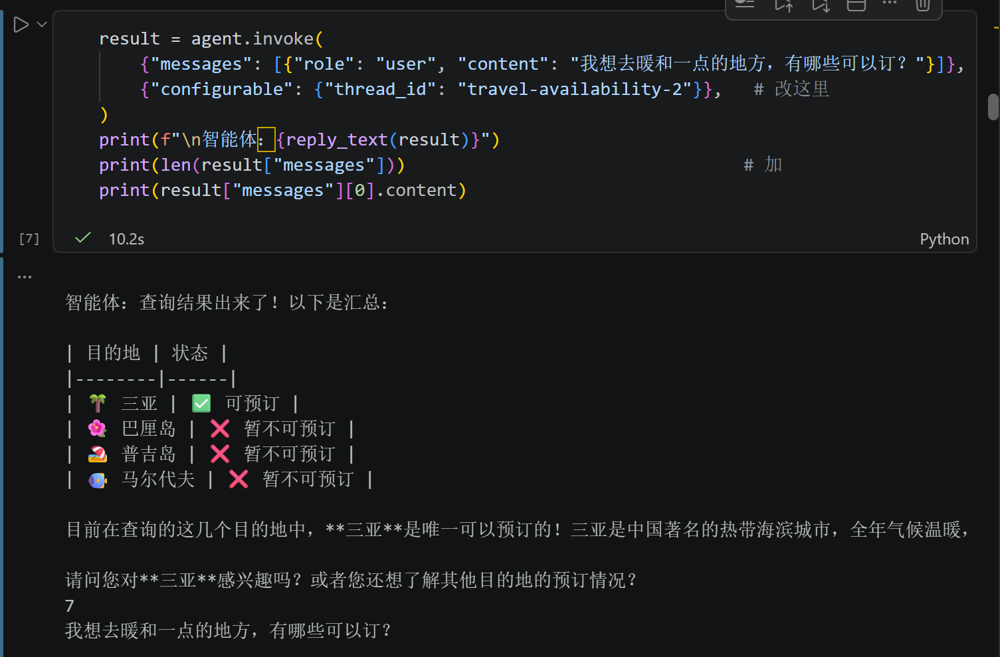
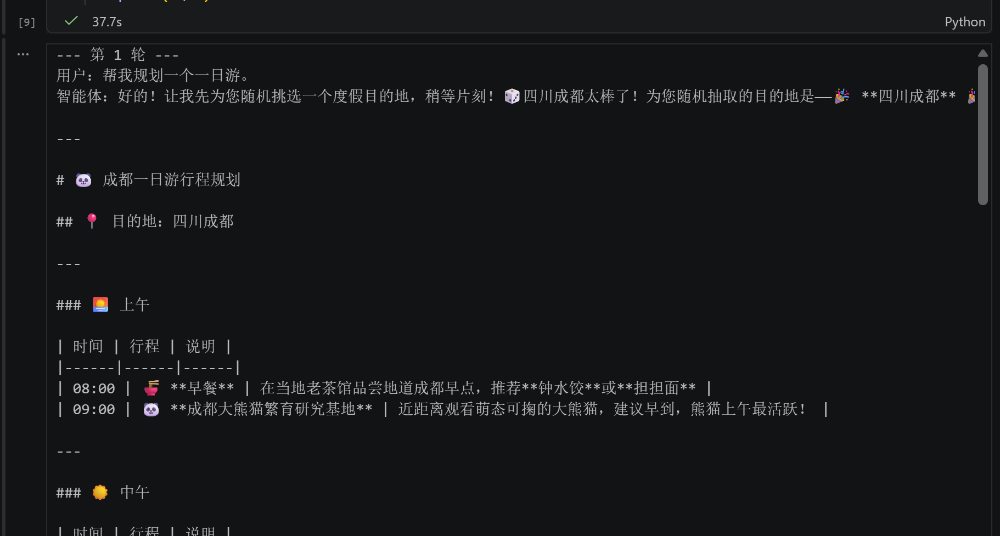
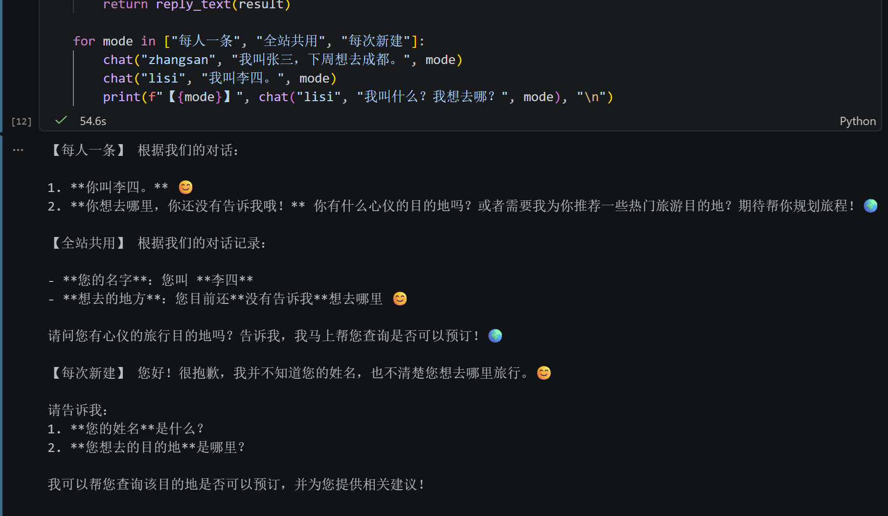
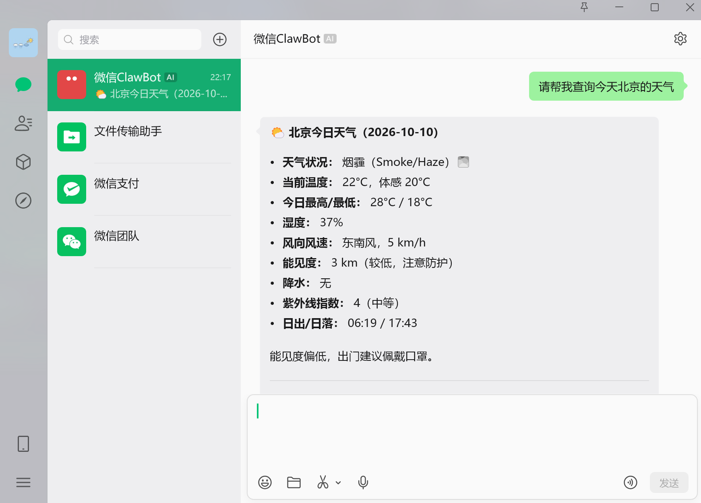

# 第 2 周作业 · 探索智能体框架

## 一、课堂练习截图





.png)

.png)



.png)

## 二、作业一：Dify Agent 应用

### 1. 全景图归属说明
- **全景图位置**：低代码平台那一行 + 自主智能体（由模型决定下一步）那一格。
- **说明原因**：该应用基于低代码可视化界面搭建与配置（提示词设定、接入模型与绑定工具），但运行时并未通过硬编码连线画死每一步分支；而是将业务目标与工具集（如 DuckDuckGo Search）交由大模型，由模型基于 ReAct 思考循环自主判断是否需要调用工具查询，并将工具观察结果汇总为自然语言回复给用户。

### 2. API 调用命令

```bash
curl -X POST "https://api.dify.ai/v1/chat-messages" \
  -H "Authorization: Bearer app-************************" \
  -H "Content-Type: application/json" \
  -d '{
    "inputs": {},
    "query": "你好，请问北京今天天气怎么样？",
    "response_mode": "streaming",
    "user": "student-2025222010006"
  }'
```

### 3. API 调用输出返回

```text
data: {"event":"agent_thought","conversation_id":"9c7707e5-78aa-47e1-8e93-cb247ccded51","message_id":"f484da07-e2b6-4a64-af9e-197180940850","created_at":1791638576,"task_id":"ee78f33a-60c1-4f1e-94ce-8baaf18cd493","id":"db749b1c-b4e4-4e18-ab52-1b95d19e9d1e","position":1,"thought":"<think>\n<!--dify-deepseek-reasoning-->The user asks about Beijing weather today. I must call the tool to query weather.\n</think>你好！我来帮你查询北京今天的天气情况。","observation":"{\"ddgo_search\": \"...\"}","tool":"ddgo_search","tool_labels":{"ddgo_search":{"en_US":"ddgo_search","zh_Hans":"ddgo_search"}},"tool_input":"{\"ddgo_search\": {\"query\": \"北京今天天气\"}}","message_files":[]}

data: {"event":"agent_thought","conversation_id":"9c7707e5-78aa-47e1-8e93-cb247ccded51","message_id":"f484da07-e2b6-4a64-af9e-197180940850","created_at":1791638576,"task_id":"ee78f33a-60c1-4f1e-94ce-8baaf18cd493","id":"265056ec-eb51-4273-82c9-6caa94a95cfb","position":2,"thought":"<think>\n<!--dify-deepseek-reasoning-->The search results give some info. Let me summarize...\n</think>根据查询结果，北京今天天气情况大致如下：\n\n🌤️ **北京今日天气**\n- **天气状况**：晴（部分时段有轻度雾霾）\n- **气温**：大约在 **16℃ ~ 28℃** 之间\n- **风力**：北风/东北风，1级左右，风力不大\n- **早晚温差**：昼夜温差较大，早晚偏凉，中午较暖和\n\n👕 **穿衣建议**：建议采用\"洋葱式\"穿搭，早晚可以加件外套或薄夹克，中午热了方便脱掉。今天阳光较好，出门注意防晒；如有轻度雾霾，敏感人群可适当佩戴口罩。\n\n⚠️ 温馨提示：以上信息来自网络天气平台，天气数据实时变动，建议你出行前再查看一下当地气象台的最新预报，以获得更准确的实时信息。祝你今天出行愉快！","observation":"","tool":"","tool_labels":{},"tool_input":"","message_files":[]}

data: {"event":"message_end","conversation_id":"9c7707e5-78aa-47e1-8e93-cb247ccded51","message_id":"f484da07-e2b6-4a64-af9e-197180940850","created_at":1791638576,"task_id":"ee78f33a-60c1-4f1e-94ce-8baaf18cd493","id":"f484da07-e2b6-4a64-af9e-197180940850","metadata":{"retriever_resources":[],"usage":{"prompt_tokens":1359,"completion_tokens":381,"total_tokens":1740,"currency":"USD","latency":4.571},"reasoning":{}},"files":[]}
```

## 三、作业二：OpenClaw 接微信聊天

### 1. `openclaw gateway status` 输出

```text
Service: no supported service manager detected (diagnostic only, not the probe target)
File logs: /tmp/openclaw/openclaw-2026-10-10.log
Host desktop: disabled

Config (cli): ~/.openclaw/openclaw.json
Config (service): ~/.openclaw/openclaw.json

Gateway: bind=loopback (127.0.0.1), port=18789 (env/config)
Probe target: ws://127.0.0.1:18789
Dashboard: http://127.0.0.1:18789/
Probe note: Loopback-only gateway; only local clients can connect.

CLI version: 2026.9.9 (/usr/bin/openclaw)
Gateway version: 2026.9.9

Runtime: unknown (diagnostic only, not the probe target)
Connectivity probe: ok
Capability: connected-no-operator-scope

Listening: 127.0.0.1:18789
Troubles: run openclaw status
Troubleshooting: https://docs.openclaw.ai/troubleshooting
```

### 2. 微信多轮聊天截图

> 完成了 3 轮完整对话，包含查询天气（动用外部网络工具）、询问当前星期与日期、以及自我介绍。

第一轮：查询北京天气（触发技能与工具调用）


第二、三轮：日期查询与自我介绍多轮对话
.png)

### 3. `~/.openclaw` 会话记录片段（包含工具调用）

以下截取自 `~/.openclaw` 导出的会话事件轨迹（`events.jsonl`），记录了用户在微信发送“请帮我查询今天北京的天气”后，OpenClaw 智能体自主加载天气技能规范、调用 `web_fetch` 抓取外部天气数据并最终生成回复的完整过程：

```json
{"type":"prompt.submitted","ts":"2026-10-10T14:16:49.612Z","data":{"prompt":"请帮我查询今天北京的天气","systemPrompt":{"limitChars":32768},"messages":[{"role":"user","content":[{"type":"text","text":"请帮我查询今天北京的天气"}],"idempotencyKey":"channel-user:v1:7105b4410da569ba40c5610f9acb5440"}]}}
{"type":"tool.call","ts":"2026-10-10T14:17:01.081Z","data":{"name":"read","arguments":{"path":"/usr/lib/node_modules/openclaw/skills/weather/SKILL.md"},"toolCallId":"toolu_vrtx_014LQ9ZeuyrmLis63AnUA8eM"}}
{"type":"tool.call","ts":"2026-10-10T14:17:01.081Z","data":{"name":"read","arguments":{"path":"$WORKSPACE_DIR/.openclaw/workspace/IDENTITY.md"},"toolCallId":"toolu_vrtx_01GiwsA3aPQhRC2Dke6T3L2L"}}
{"type":"tool.result","ts":"2026-10-10T14:17:01.607Z","data":{"name":"read","toolCallId":"toolu_vrtx_014LQ9ZeuyrmLis63AnUA8eM","success":true}}
{"type":"tool.call","ts":"2026-10-10T14:17:05.952Z","data":{"name":"web_fetch","arguments":{"url":"https://wttr.in/Beijing?format=j2","extractMode":"text","maxChars":12000},"toolCallId":"toolu_vrtx_01FJFnyALSXrLj74h1hkSEwJ"}}
{"type":"tool.result","ts":"2026-10-10T14:17:11.093Z","data":{"name":"web_fetch","toolCallId":"toolu_vrtx_01FJFnyALSXrLj74h1hkSEwJ","success":true}}
{"type":"model.completed","ts":"2026-10-10T14:17:21.544Z","data":{"usage":{"input":23272,"output":976,"cacheRead":31997,"total":56245},"stopReason":"end_turn"}}
```

### 4. 架构分析：一条微信消息流转经过的层级

对照课件中的架构图三（OpenClaw 自主执行型智能体架构），一条微信消息从用户发送到接收回复依次经过了以下 5 个关键层级：

1. **渠道适配层（Channel Adapter / `@tencent-weixin/openclaw-weixin`）**：
   微信客户端发出的私有网络协议消息到达后，微信渠道插件将其统一解析并转换成 OpenClaw 标准的 `UnifiedMessage` 数据结构，屏蔽了具体聊天平台的协议差异。
2. **网关控制面（Gateway Daemon，监听 `127.0.0.1:18789`）**：
   网关作为系统的中心控制面与消息总线，负责鉴权，并根据 `workspace:channel:userId` 会话键将消息分发进当前用户独占的串行车道队列（Lane Queue），保证单个会话串行执行且无并发竞态；同时在必要时对危险指令执行安全审批策略。
3. **智能体自主运行时（Agent Runtime）**：
   Agent 在自主目标循环中运行，没有预设死板的图节点（Graph），而是根据会话目标自主规划。在收到查天气意图后，动态检索并读取 Skills 库指令（`skills/weather/SKILL.md`），并自主决定调用 Tools（`web_fetch` 发起网络请求获取实时天气）。
4. **模型与记忆交互层（LLM Provider & Workspace / Memory）**：
   Agent 将历史对话、`~/.openclaw/workspace` 中的上下文记忆（`USER.md`、`IDENTITY.md`）和工具执行结果整合为提示词，通过反向端口（`127.0.0.1:8045`）调用配置好的 Claude 模型进行推理，生成格式化的天气总结答复；同时将会话事件持久化存储到本地 SQLite 与 JSONL 日志中。
5. **反向路由响应交付**：
   模型生成的最终回答沿原链路返回：Agent Runtime 封装结果 → Gateway 路由分发 → 渠道适配器将文本编码回微信消息协议并发送至微信后台 → 最终呈现在用户的微信聊天界面中。
