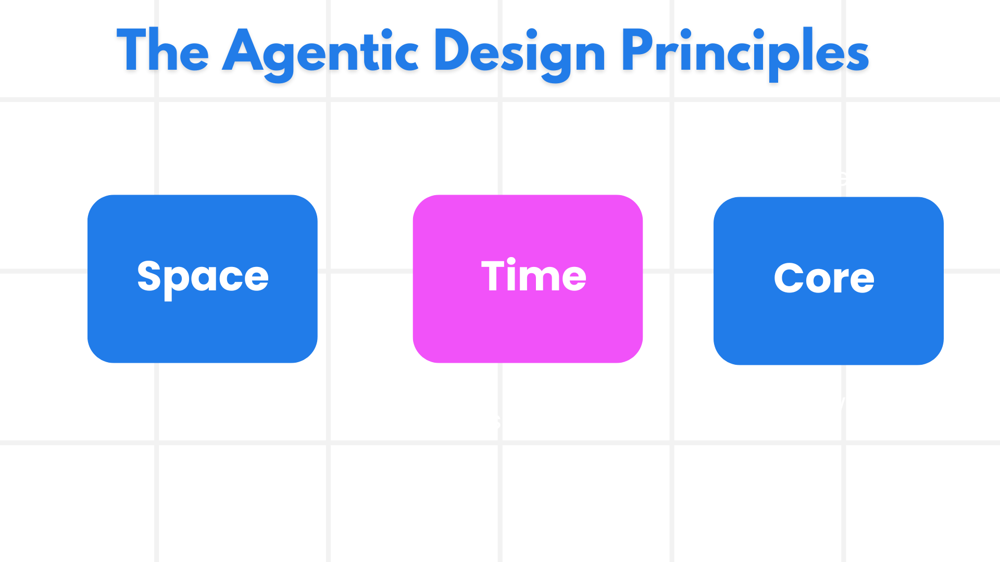

# AI 智能体设计原则

## 简介

构建 AI 智能体系统的思路有很多。在生成式 AI 的设计里，模糊性是一种特性而不是缺陷，因此工程师常常连从哪儿下手都很难判断。为此我们整理了一套以人为中心的 UX 设计原则，帮助开发者围绕客户需求构建智能体系统、解决业务问题。这些设计原则不是一套规定死的架构，而是给正在定义和构建智能体体验的团队一个起点。

总体来说，智能体应该：

- 拓展并放大人的能力（头脑风暴、问题求解、自动化等）
- 补足知识盲区（快速带我入门某个领域、翻译等）
- 按照我们各自习惯的协作方式，促进并支撑协作
- 让我们成为更好的自己（例如生活教练／任务管家，帮我们学会情绪调节与正念，增强韧性等）

## 这一课会讲

- 什么是智能体设计原则
- 落地这些设计原则时可以遵循哪些指南
- 使用这些设计原则的一些例子

## 学习目标

学完这一课，你将能够：

1. 说清楚什么是智能体设计原则
2. 说清楚使用智能体设计原则的指南
3. 理解如何依据智能体设计原则构建一个智能体

## 智能体设计原则



### 智能体（空间维度）

指智能体所处的环境。这些原则说明我们该如何设计在物理世界和数字世界中活动的智能体。

- **连接，而不是压缩** —— 帮助人与人、人与事件、人与可付诸行动的知识建立连接，让协作和联系成为可能。
- 智能体帮助连接事件、知识和人。
- 智能体让人们彼此更近，而不是取代或贬低人。
- **随手可及，但偶尔隐身** —— 智能体大多在后台运行，只在合适且相关时才提醒我们。
  - 对于已授权用户，智能体在任何设备或平台上都易于发现、易于使用。
  - 智能体支持多模态的输入与输出（声音、语音、文字等）。
  - 智能体能够在前台与后台之间、主动与被动之间自然切换，取决于它对用户需求的感知。
  - 智能体可以以隐身形态运行，但它的后台处理路径以及与其他智能体的协作，对用户是透明且可控的。

### 智能体（时间维度）

指智能体随时间如何运作。这些原则说明我们该如何设计跨越过去、现在与未来进行交互的智能体。

- **过去**：回顾包含状态与上下文在内的历史。
  - 智能体基于对更丰富历史数据的分析给出更贴切的结果，而不只看单个事件、人或状态。
  - 智能体在过去发生的事件之间建立联系，并主动回顾记忆来应对当前情境。
- **现在**：多用轻推，而不是通知。
  - 智能体以一种整体的方式与人互动。事件发生时，智能体不止于静态通知或其他刻板形式，而是可以简化流程、动态生成提示，在恰当的时刻引导用户的注意力。
  - 智能体依据所处的上下文环境、社会与文化变化来传递信息，并贴合用户意图。
  - 智能体的交互可以循序渐进、逐步变得更复杂，从长期来看不断增强用户的能力。
- **未来**：适应与演进。
  - 智能体能适应各种设备、平台与交互模态。
  - 智能体能适应用户行为与无障碍需求，并且可以自由定制。
  - 智能体在持续的用户交互中被塑造并不断演进。

### 智能体（核心）

这些是智能体设计核心中的关键要素。

- **接受不确定性，同时建立信任**。
  - 智能体存在一定程度的不确定性是正常的，不确定性是智能体设计的关键要素之一。
  - 信任与透明是智能体设计的基础层。
  - 智能体何时开启／关闭由人掌控，且其状态始终清晰可见。

## 落地这些原则的指南

运用上述设计原则时，遵循下面这些指南：

1. **透明**：告诉用户有 AI 参与其中、它如何工作（包括过去做过什么），以及如何提供反馈、如何修改系统。
2. **可控**：让用户能够定制、指定偏好并做个性化设置，能控制系统及其各项属性（包括"遗忘"的能力）。
3. **一致**：在各种设备与终端上追求一致的多模态体验。尽可能使用用户熟悉的 UI/UX 元素（例如用麦克风图标表示语音交互），并尽量减轻用户的认知负担（例如追求简洁的回答、配合视觉辅助以及"了解更多"的补充内容）。

## 如何用这些原则和指南设计一个旅行智能体

假设你正在设计一个旅行智能体，可以这样运用这些设计原则与指南：

1. **透明** —— 让用户知道这个旅行智能体是由 AI 驱动的。提供一些上手的基本说明（例如一句"你好"的欢迎语、示例提示词）。在产品页面上把这些写清楚。展示用户过去问过的提示词列表。明确说明如何提供反馈（点赞／点踩、"发送反馈"按钮等）。如果智能体在用途或话题上有限制，也要讲清楚。
2. **可控** —— 让用户清楚地知道，智能体创建之后可以怎样修改，比如通过系统提示词。允许用户选择智能体回答的详细程度、写作风格，以及哪些话题不该谈。允许用户查看并删除相关的文件或数据、提示词和历史对话。
3. **一致** —— 确保"分享提示词"、添加文件或照片、@某人或某物这些图标是标准且易于辨认的。用回形针图标表示向智能体上传／分享文件，用图片图标表示上传图形。

## 示例代码

- Python：[用 LangChain 实现智能体设计模式](./code_samples/03-python-langchain-agent.ipynb)

## 作业：两个智能体，一次经过校验的交接

本课的 notebook 分三步构建了一个旅行推荐系统：一个只由一段详细 `system_prompt` 驱动的智能体；一个通过 `response_format=` 返回经过校验的 Pydantic 对象的智能体；以及两个单一职责的智能体，交接一个 `DestinationChoice`。请在一个**不同的领域**里重做这几步，这个领域要有一个智能体负责*做选择*，另一个负责*围绕这个选择做规划*：选课顾问、找房助手、餐食规划、招聘助手。

### 要求

1. **新建一个 notebook**，放在 `code_samples/` 目录下，命名为 `03-assignment-<你的主题>.ipynb`。开头使用与课程 notebook 相同的环境准备单元，从 `.env` 读取 `LLM_BASE_URL`、`LLM_API_KEY` 和 `LLM_MODEL`。绝不要把 API key 直接粘贴进 notebook。
2. **写一个"清晰指令"智能体**：`create_agent(llm, tools=[], system_prompt=...)`。提示词必须给出人设、至少三条带编号的职责和一件智能体必须坦白说明的事，就像小安对实时价格那样。调用它一次，并在一个 markdown 单元里记下每条指令分别在哪里得到了体现。
3. **定义两个 Pydantic 模型**：一个条目模型，至少四个字段，其中要有一个 `bool` 和一个 `list[str]`；一个包装模型，包含条目的 `list[...]` 以及一个像 `personalized_note` 这样的自由文本字段。写一个带 `Annotated` 参数的 `@tool`，像 `get_destination_details` 那样返回条目模型的*实例*。
4. **创建一个结构化输出智能体**，传入这个工具，并把包装模型作为 `response_format=`。逐个字段打印 `result["structured_response"]`；绝不要调用 `json.loads`。
5. **把工作拆给两个智能体。** 第一个使用上面的工具和一个 `response_format=` 选择模型：主字段是一个 `Literal[...]`，限定为工具覆盖的那些名字，再加上 `pros`、`cons` 和 `rationale`；它的提示词以一行"不要……"结尾。第二个 `tools=[]`，在用户消息里收到 `choice.model_dump_json()`，它的提示词禁止更改这个选择。
6. **以一个反思 markdown 单元收尾**，三到五句话：设置 `response_format=` 之后有什么变化？`Literal` 字段让什么变得不可能？第二个智能体有没有推翻过这个选择？把两个智能体合并成一段提示词会失去什么？

你的 notebook 必须能从上到下无错误地运行。用课程同样的方式检查它，在仓库根目录运行：

```bash
python scripts/validate_notebooks.py --path 03-agentic-design-patterns/code_samples/03-assignment-<你的主题>.ipynb
```

### 提交前自查

- notebook 的代码里没有写死任何 API key、模型名或接口地址。
- 第一段系统提示词有人设、带编号的职责和一条透明性要求。
- 结构化输出是从 `result["structured_response"]` 打印的，没有 `json.loads`。
- 选择模型用了 `Literal[...]`，打印出的选择是被覆盖的名字之一。
- 第二个智能体保留了第一个的选择，两段提示词都含有"不要……"一行。
- 反思单元回答了全部四个问题。

### 进阶目标（可选）

- 给包装模型加一个 `field_validator`，例如预算上限，看看校验失败时会发生什么。
- 给第一个智能体加上第 02 课的 `checkpointer=InMemorySaver()`，用两轮对话细化偏好。
- 第 04 课会用 `HumanInTheLoopMiddleware` 给有副作用的工具加门。给你的第二个智能体加一个必须等待批准的 `book_...` 工具。

## 关于智能体设计模式还有疑问？

在本仓库提一个 issue，写清课程编号和你尝试过什么。

## 延伸阅读

- [Practices for Governing Agentic AI Systems | OpenAI](https://openai.com/index/practices-for-governing-agentic-ai-systems/)
- [智能体设计模式（LangGraph 文档）](https://docs.langchain.com/oss/python/langgraph/overview)

## 上一课

[探索智能体框架](../02-explore-agentic-frameworks/README.md)

## 下一课

[工具使用设计模式](../04-tool-use/README.md)
